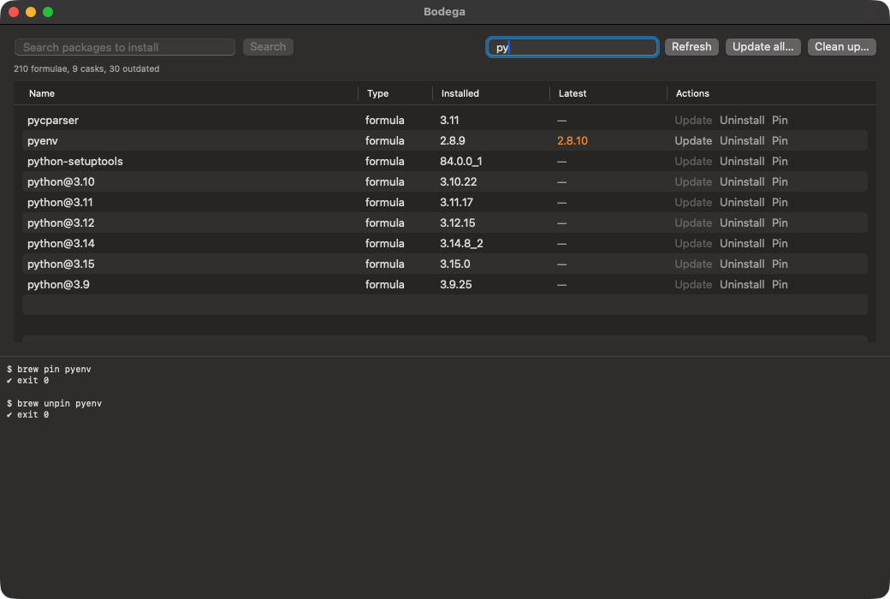
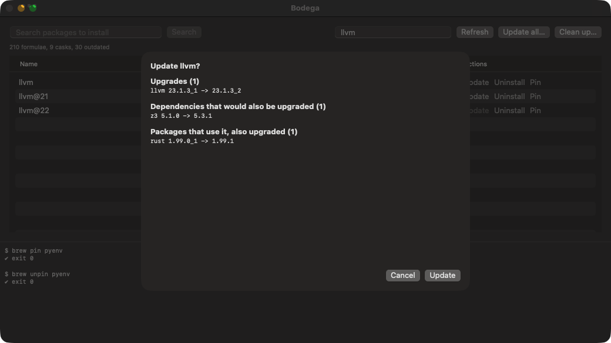

# Bodega

[](https://github.com/asolfre/bodega/actions/workflows/ci.yml)
[](https://github.com/asolfre/bodega/releases/latest)
[](LICENSE)


**A native macOS Homebrew GUI, built with SwiftUI.** Search, install, update, pin, uninstall and clean up
formulae and casks, and see every dependency, dependent and source build before an upgrade runs.
Every action is a plain `brew` command; Bodega changes nothing that brew itself would not. No Electron,
no web view.





## Install

1. Download `Bodega-<version>-macos-arm64.zip` from the [latest release](https://github.com/asolfre/bodega/releases/latest),
   unzip it and move `Bodega.app` to Applications.
2. Bodega is not notarized by Apple, so macOS blocks the first launch. Open it once, then go to
   **System Settings → Privacy & Security** and click **Open Anyway**. Or, in Terminal:

   ```sh
   xattr -dr com.apple.quarantine /Applications/Bodega.app
   ```

Each release has a `.sha256` file next to the zip (`shasum -a 256 -c Bodega-*.zip.sha256`).

Or build it yourself (below); a build made on your Mac opens without that step.

## Requirements

- macOS 14 or later, Apple silicon (release builds are arm64; tested on Apple silicon only)
- Homebrew in `/opt/homebrew` or `/usr/local`
- To build: Xcode, or Command Line Tools older than 27.0. Command Line Tools 27.0 can't build SwiftUI
  apps against the macOS 27 SDK (they lack SwiftUI's macro plugin), so `build.sh` uses
  `/Applications/Xcode.app` when it is installed.

## Build from source

```sh
git clone https://github.com/asolfre/bodega.git && cd bodega
./build.sh            # builds build.noindex/Bodega.app
./build.sh --install  # also copies it to ~/Applications (Spotlight finds that copy only)
```

The SwiftPM build folder lives in `$TMPDIR/bodega-build`, outside the project. The app is signed ad hoc.

## What it does

| Feature | brew command |
|---|---|
| Installed list (version in use first, older versions grey) | `brew list --versions`, the `$(brew --prefix)/opt` links |
| Outdated, pinned, untrusted-tap labels | `brew outdated --json=v2`, `brew list --pinned`, `brew trust --json=v1` |
| Search and install | `brew search --formula/--cask`, `brew install` |
| Update one package / Update all | `brew upgrade [name]`, after `brew upgrade --dry-run` |
| Uninstall, pin, unpin | `brew uninstall`, `brew pin`, `brew unpin` |
| Clean up | `brew cleanup`, after `brew cleanup -n` |
| Cancel a running action | SIGINT to brew, same as Ctrl-C |

Before an update, Bodega shows what brew would really do: the packages you asked for, dependencies it
would upgrade or install, packages that use it and would be upgraded too, deprecated packages, brew's
one-line warnings (e.g. "pkgconf would be reinstalled due to macOS version mismatch"), and which
formulae would **compile from source**. brew's own dry run only lists source builds for the packages
you asked for; Bodega checks every formula involved (an official-tap formula with no bottle for this
Mac compiles). A single update with nothing else to it starts straight away.

Every action and each line brew prints is written with a timestamp to `~/Library/Logs/Bodega.log`.
At launch, a log over 5 MB becomes `Bodega.log.1` and a new one starts.

## Checks

`swift test` and a full build run on every push and pull request
([CI](.github/workflows/ci.yml), `macos-26`). Pushing a `v*` tag builds the app and publishes the zip
([Release](.github/workflows/release.yml)); the tag must match `VERSION` in `build.sh`.

```sh
# unit tests for everything that parses brew output (DEVELOPER_DIR: see Requirements)
DEVELOPER_DIR=/Applications/Xcode.app/Contents/Developer swift test --scratch-path "$TMPDIR/bodega-build"
```

`parity.sh` compares what the app shows with the brew CLI: packages and versions, outdated, active
versions, pinned and untrusted taps. Start the app with a dump file, then run it:

```sh
open -n build.noindex/Bodega.app --env BODEGA_DUMP=/tmp/ui.tsv
./parity.sh /tmp/ui.tsv     # expect five "MATCH" lines
```

### Driving the UI

These need **Accessibility** (and **Screen Recording** for screenshots) for the app that runs them.

- `ui.js` clicks and reads controls by their accessibility id:
  `osascript -l JavaScript ui.js click update-jq`, `type search-field tree submit`, `read status`,
  `wait <id> [sec]`, `dialog <button>`, `sheet-text`, `sheet-ids`, `enabled <id>`.
- `shot.sh out.png` captures the Bodega window, on any display.
- `fake-brew.sh` stands in for brew so confirmations can be tested safely. A real `cleanup` or
  `upgrade` is only written to `$TMPDIR/bodega/fake-actions.log`; everything else goes to real brew.
  Copy it to a local folder first (macOS may not let the app run a script from a cloud-synced folder),
  then start the app with it:

  ```sh
  cp fake-brew.sh "$TMPDIR/bodega/fake-brew.sh"
  open -n build.noindex/Bodega.app --env BODEGA_BREW="$TMPDIR/bodega/fake-brew.sh"
  ```

## Versions

`VERSION` in `build.sh` sets the version; the build number is the git commit count. Releases are git
tags: `v0.1.0` (list, update, uninstall, install), `v0.2.0` (search, pin, cleanup, update all, cancel,
live log), `v0.2.1` (source builds found for every dependency, `brew --prefix`, log rotation, this README),
`v0.2.2` (dependents, deprecated packages and brew's warnings in the update sheet; wording for any macOS),
`v0.2.3` (first public release: license, CI, release downloads).

## Releasing

1. Set `VERSION` in `build.sh` and commit.
2. Create an annotated tag; its message becomes the release notes: `git tag -a v0.2.4`.
3. Push both: `git push origin main v0.2.4`.

The [Release](.github/workflows/release.yml) workflow then checks that the tag matches `VERSION`, runs
the tests, builds the app on GitHub's runner and publishes `Bodega-<version>-macos-arm64.zip` with its
`.sha256` file.

## Known limits

- **Source builds.** A formula with no bottle for this Mac compiles from source, which can take hours.
  That was most updates on macOS 14 (Homebrew Tier 3, no new bottles); on current macOS it is rare.
  Bodega asks brew for this Mac's bottle tag at every launch, warns before such an update starts,
  and Cancel stops it.
- **Untrusted taps.** brew refuses to load formulae from taps you have not trusted (`brew trust`).
  Bodega labels them; actions on them show brew's error.
- **Casks** with `auto_updates` or `version :latest` are not in Update all (no `--greedy`).
- Not included: taps, services, `brew doctor`, sudo prompts.

## License

[MIT](LICENSE)
