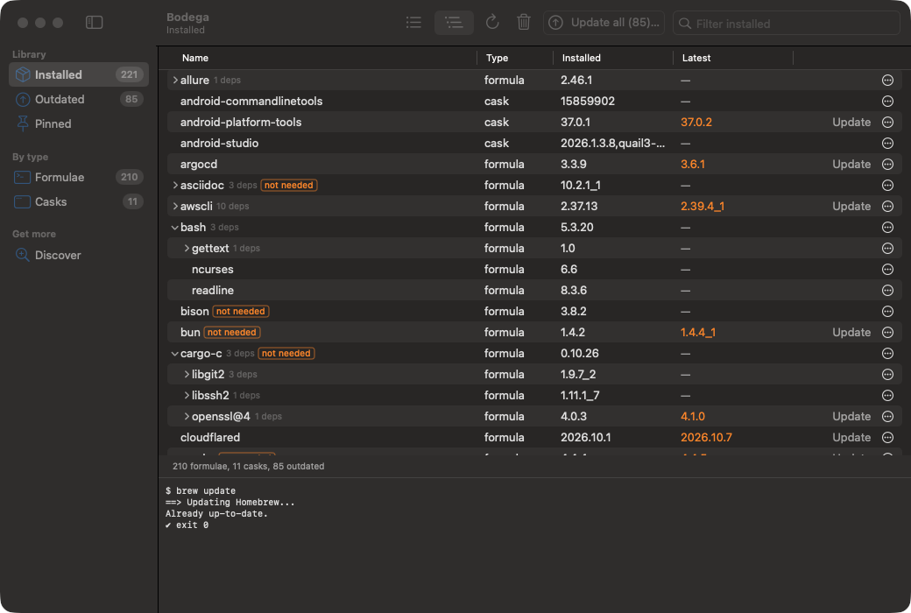
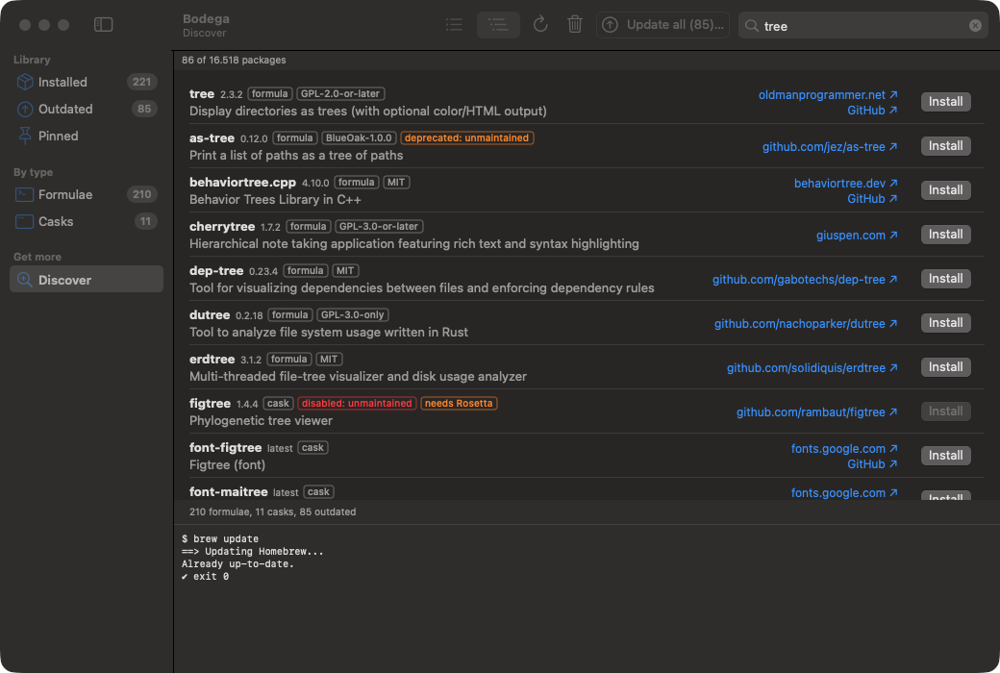
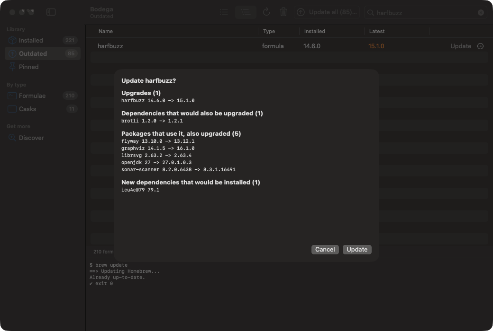

<p align="center"></p>

# Bodega

[](https://github.com/asolfre/bodega/actions/workflows/ci.yml)
[](https://github.com/asolfre/bodega/releases/latest)
[](LICENSE)


**A native macOS Homebrew GUI, built with SwiftUI.** Browse every Homebrew package with its license, links
and warnings; install, update, pin, uninstall and clean up formulae and casks; see what your packages depend
on as a tree; and see every dependency, dependent and source build before an install or upgrade runs.
Every action is a plain `brew` command; Bodega changes nothing that brew itself would not. No Electron,
no web view.







## Install

1. Download `Bodega-<version>-macos-arm64.zip` from the [latest release](https://github.com/asolfre/bodega/releases/latest),
   unzip it and move `Bodega.app` to Applications.
2. Bodega is not notarized by Apple, so macOS blocks the first launch. Open it once, then go to
   **System Settings → Privacy & Security** and click **Open Anyway**. Or, in Terminal:

   ```sh
   xattr -dr com.apple.quarantine /Applications/Bodega.app
   ```

Each release has a `.sha256` file next to the zip (`shasum -a 256 -c Bodega-*.zip.sha256`).

Or build it yourself (below); a build made on your Mac opens without that step.

## Requirements

- macOS 14 or later, Apple silicon (release builds are arm64; tested on Apple silicon only)
- Homebrew in `/opt/homebrew` or `/usr/local`
- To build: Xcode, or Command Line Tools older than 27.0. Command Line Tools 27.0 can't build SwiftUI
  apps against the macOS 27 SDK (they lack SwiftUI's macro plugin), so `build.sh` uses
  `/Applications/Xcode.app` when it is installed.

## Build from source

```sh
git clone https://github.com/asolfre/bodega.git && cd bodega
./build.sh            # builds build.noindex/Bodega.app
./build.sh --install  # also copies it to ~/Applications (Spotlight finds that copy only)
```

The SwiftPM build folder lives in `$TMPDIR/bodega-build`, outside the project. The app is signed ad hoc.

## What it does

| Feature | Where it comes from |
|---|---|
| Installed list (version in use first, older versions grey) | `brew list --versions`, the `$(brew --prefix)/opt` links |
| Outdated, pinned, untrusted-tap labels | `brew outdated --json=v2`, `brew list --pinned`, `brew trust --json=v1` |
| Sidebar: Installed, Outdated, Pinned, Formulae, Casks (⌘F filters the section shown) | the same data |
| Installed as a tree: each package's direct dependencies under it; "not needed" on dependencies nothing installed needs any more (what `brew autoremove` would remove) | each formula's and cask's `INSTALL_RECEIPT.json` (`runtime_dependencies`, `installed_on_request`) |
| New versions (at launch and on Refresh) | `brew update`, then the commands above |
| Search and install (**Discover** in the sidebar, ⌘N: every Homebrew package, narrowed as you type in the toolbar field; each row shows version, license, warnings (disabled, deprecated, "no bottle for this Mac", needs Rosetta) and links to the homepage and the GitHub/GitLab/Codeberg project) | the package list `brew update` keeps in Homebrew's cache, `brew install` |
| Update one package / Update all | `brew upgrade [name]`, after `brew upgrade --dry-run` |
| Uninstall, pin, unpin | `brew uninstall`, `brew pin`, `brew unpin` |
| Clean up | `brew cleanup`, after `brew cleanup -n` |
| Cancel a running action | SIGINT to brew, same as Ctrl-C |

Before an update, Bodega shows what brew would really do: the packages you asked for, dependencies it
would upgrade or install, packages that use it and would be upgraded too, deprecated packages, brew's
one-line warnings (e.g. "pkgconf would be reinstalled due to macOS version mismatch"), and which
formulae would **compile from source**. brew's own dry run only lists source builds for the packages
you asked for; Bodega checks every formula involved (an official-tap formula with no bottle that runs on
your version of macOS compiles). A single update with nothing else to it starts straight away. Install
does the same check (`brew install --dry-run`): a package with dependencies, a source build or a warning
asks first.

Every action and each line brew prints is written with a timestamp to `~/Library/Logs/Bodega.log`.
At launch, a log over 5 MB becomes `Bodega.log.1` and a new one starts.

## Checks

`swift test` and a full build run on every pull request and every push to `main`
([CI](.github/workflows/ci.yml), `macos-26`). Pushing a `v*` tag builds the app and publishes the zip
([Release](.github/workflows/release.yml)); the tag must match `VERSION` in `build.sh`.

```sh
# unit tests for everything that parses brew's output and files (DEVELOPER_DIR: see Requirements)
DEVELOPER_DIR=/Applications/Xcode.app/Contents/Developer swift test --scratch-path "$TMPDIR/bodega-build"
```

`parity.sh` compares what the app shows with the brew CLI: packages and versions, outdated, active
versions, pinned and untrusted taps. Start the app with a dump file, then run it:

```sh
open -n build.noindex/Bodega.app --env BODEGA_DUMP=/tmp/ui.tsv
./parity.sh /tmp/ui.tsv     # expect five "MATCH" lines
```

The app runs `brew update` at launch and writes the dump again afterwards: run `parity.sh` only once the
status line shows the package counts again after the `brew update` exit line
(`osascript -l JavaScript ui.js read status`).

`parity.sh` shows that the app and brew agree on the same saved data, not that the data is fresh. That
`brew update` fetched shows in the `.git/FETCH_HEAD` times of `$(brew --repository)` and of each tap.

Before Bodega runs a new brew command, read its source in `$(brew --repository)/Library/Homebrew/cmd/`:
`brew update`, for one, also reinstalls pkgconf and migrates renamed packages (`update-report.rb`).

### Driving the UI

These need **Accessibility** (and **Screen Recording** for screenshots) for the app that runs them.
Quit every other Bodega copy first, the installed one too: System Events finds controls by the name
"Bodega" and drives the first copy, so `ui.js` refuses to run while several are open. All copies also
write to the same `Bodega.log`.

- `ui.js` clicks and reads controls by their accessibility id:
  `osascript -l JavaScript ui.js click update-jq`, `type filter-field jq`, `read status`,
  `wait <id> [sec]`, `dialog <button>`, `sheet-text`, `sheet-ids`, `enabled <id>`, `close-window`.
  Sidebar sections are chosen with `select sidebar-<name>` (`installed`, `outdated`, `pinned`,
  `formulae`, `casks`, `discover`). To search Homebrew: `select sidebar-discover`, then
  `type filter-field tree`; each row's button is `install-formula:tree`. Uninstall and Pin sit in each
  row's ⋯ menu (`click actions-jq`) and right-click menu.
  After launch the rows appear before the buttons work: they stay disabled until `brew update` ends,
  so repeat `enabled refresh-button` until it says `enabled` before clicking.
- `shot.sh out.png` captures the Bodega window, on any display.
- `fake-brew.sh` stands in for brew so confirmations can be tested safely. A real `cleanup`,
  `upgrade` or `install` is only written to `$TMPDIR/bodega/fake-actions.log`; everything else goes to
  real brew. Copy it to a local folder first (macOS may not let the app run a script from a cloud-synced
  folder), then start the app with it:

  ```sh
  cp fake-brew.sh "$TMPDIR/bodega/fake-brew.sh"
  open -n build.noindex/Bodega.app --env BODEGA_BREW="$TMPDIR/bodega/fake-brew.sh"
  ```

## Versions

`VERSION` in `build.sh` sets the version; the build number is the git commit count. Releases are git
tags: `v0.1.0` (list, update, uninstall, install), `v0.2.0` (search, pin, cleanup, update all, cancel,
live log), `v0.2.1` (source builds found for every dependency, `brew --prefix`, log rotation, this README),
`v0.2.2` (dependents, deprecated packages and brew's warnings in the update sheet; wording for any macOS),
`v0.2.3` (first public release: license, CI, release downloads), `v0.2.4` (new icon: five casks),
`v0.2.5` (brew update at launch and on Refresh).

## Releasing

1. Set `VERSION` in `build.sh` and commit.
2. Create an annotated tag; its message becomes the release notes: `git tag -a vX.Y.Z`.
3. Push both: `git push origin main vX.Y.Z`.

The [Release](.github/workflows/release.yml) workflow then checks that the tag matches `VERSION`, runs
the tests, builds the app on GitHub's runner and publishes `Bodega-<version>-macos-arm64.zip` with its
`.sha256` file.

## Known limits

- **Source builds.** When Homebrew has no bottle (ready-made build) of a formula that runs on your
  version of macOS, it compiles it from source, which can take hours. That was most updates on macOS 14
  (Homebrew Tier 3, no new bottles); on current macOS it is rare. Before an update or install, Bodega
  checks every formula involved, warns before one would compile, and Cancel stops it.
- **Untrusted taps.** brew refuses to load formulae from taps you have not trusted (`brew trust`).
  Bodega labels them; actions on them show brew's error.
- **brew update** runs at launch and on Refresh. Besides fetching new versions, brew rebuilds pkgconf
  from source after a macOS update and moves packages that were renamed or moved to another tap.
  All of it shows in the log, and Cancel stops it. Offline, Bodega keeps the saved data and the log
  shows brew's error.
- **Casks** with `auto_updates` or `version :latest` are not in Update all (no `--greedy`).
- **Discover** lists Homebrew's official formulae and casks only (third-party taps are not in brew's
  cached package list).
- **Closing the window**: a Dock click brings no window back; use File › New Bodega Window (⇧⌘N), or
  ⌘N to open one on Discover.
- Not included: taps, services, `brew doctor`, sudo prompts, removing the dependencies tagged
  "not needed" (`brew autoremove`).

## License

[MIT](LICENSE)
